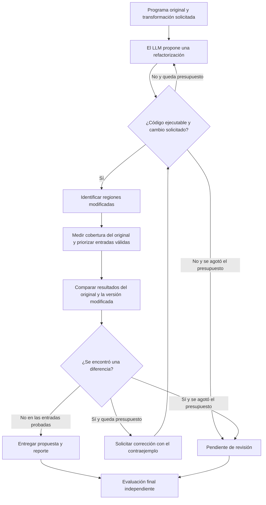

# Refactorización de código Python asistida por modelos de lenguaje y guiada por contraejemplos

## Resumen

La refactorización modifica la estructura interna del software buscando mejorar su calidad sin alterar el comportamiento observable. Los modelos de lenguaje de gran escala pueden proponer refactorizaciones, pero sus modificaciones pueden introducir errores que las pruebas disponibles no detectan. Este trabajo propone diseñar e implementar un procedimiento para refactorizar programas Python con asistencia de un modelo de lenguaje y retroalimentación obtenida mediante ejecución diferencial. El procedimiento identificará las regiones modificadas, seleccionará entradas válidas para ejercitarlas, ejecutará las versiones original y modificada y utilizará los contraejemplos encontrados para orientar una revisión acotada de la refactorización. Se plantea evaluar el método frente a alternativas con el mismo modelo y presupuestos comparables, utilizando LintEval como recurso inicial y pruebas de evaluación separadas. Las métricas considerarán la realización de la mejora solicitada, la preservación del comportamiento observada, las regresiones y el costo. La investigación busca establecer si orientar las entradas hacia los cambios aporta beneficios medibles y bajo qué condiciones. Los resultados no permitirán afirmar equivalencia para todas las entradas posibles.

**Palabras clave:** refactorización de software, modelos de lenguaje, análisis estático, pruebas diferenciales, contraejemplos, Python.

# 1. Introducción

## 1.1. Contexto

Durante el mantenimiento de software, los desarrolladores modifican el código para corregir errores, incorporar funciones o mejorar su estructura. Una de estas actividades es la refactorización, que consiste en reorganizar el código conservando su comportamiento. Por ejemplo, una función con condiciones difíciles de comprender puede reescribirse para facilitar su lectura, siempre que continúe produciendo los resultados esperados.

Los modelos de lenguaje de gran escala (LLM, por sus siglas en inglés) pueden asistir en esta tarea al proponer cambios a partir del código y de una instrucción. También pueden utilizar las advertencias de herramientas de análisis estático, que identifican características del código que podrían revisarse. LintEval es un conjunto de evaluación que estudia este tipo de cambios y considera tanto la reducción de advertencias como la preservación de la funcionalidad [1].

Al evaluar una refactorización, es necesario comprobar que el código modificado conserve el comportamiento del original. Las pruebas ayudan a realizar esa comprobación, aunque sus resultados se limitan a las entradas que se ejecutan. En su estudio de refactorizaciones generadas por LLM, Dristi y Dwyer encontraron diferencias de comportamiento que no habían sido detectadas por las pruebas disponibles en los casos analizados [2].

## 1.2. Motivación

Una refactorización puede superar las pruebas habituales y, aun así, producir un resultado diferente ante una entrada que estas no contemplan. Por ejemplo, al simplificar una función que procesa listas, la versión modificada podría funcionar correctamente con listas que tienen elementos, pero fallar con una lista vacía cuando esta es una entrada válida.

Detectar estas diferencias antes de aceptar el cambio ayudaría a revisar con mayor confianza las refactorizaciones propuestas por un LLM. En particular, interesa estudiar si las partes que cambiaron pueden orientar la selección de entradas para comparar el comportamiento de ambas versiones.

## 1.3. Definición del problema

Las refactorizaciones de programas Python propuestas por modelos de lenguaje pueden introducir cambios de comportamiento que las pruebas disponibles no detectan. Esto dificulta determinar si el código modificado conserva la funcionalidad del programa original.

## 1.4. Justificación

La investigación aborda un problema de calidad del software que surge al utilizar modelos de lenguaje para modificar código existente. Detectar diferencias entre el programa original y el refactorizado puede proporcionar evidencia útil para revisar los cambios antes de aceptarlos.

El trabajo permitirá estudiar si utilizar información de las regiones modificadas ayuda a seleccionar entradas que revelen diferencias de comportamiento. La comparación con otros procedimientos mostrará el efecto observado en las tareas evaluadas y los recursos necesarios para obtenerlo. Esta evidencia también será útil si la estrategia no ofrece ventajas o solo funciona en determinados casos.

## 1.5. Objetivos

### 1.5.1. Objetivo general

Desarrollar un procedimiento de refactorización asistida por modelos de lenguaje que contribuya a preservar el comportamiento de programas Python mediante pruebas orientadas por los cambios realizados en el código.

### 1.5.2. Objetivos específicos

1. Analizar trabajos sobre refactorización asistida por modelos de lenguaje y detección de cambios de comportamiento.
2. Definir los programas, las transformaciones y los criterios que se emplearán en la evaluación.
3. Diseñar una estrategia para seleccionar entradas válidas que ejerciten las regiones modificadas del código.
4. Implementar un prototipo que compare las ejecuciones de ambas versiones y utilice las diferencias encontradas para solicitar correcciones.
5. Evaluar el procedimiento frente a alternativas de referencia mediante pruebas funcionales reservadas y presupuestos comparables.

## 1.6. Delimitación

El estudio se centrará inicialmente en programas Python ejecutables en un entorno controlado y en transformaciones estructurales acotadas. Se considerarán casos con comportamiento determinista y con un medio comprobable para proporcionar entradas válidas.

LintEval-Lite será el punto de partida para el piloto. Su documentación describe 203 muestras Python derivadas de programas de programación competitiva [7]. Antes de definir la muestra final se comprobará cuáles pueden ejecutarse y cuentan con un procedimiento adecuado para generar entradas válidas. Los criterios de selección y exclusión se documentarán.

La evaluación observará los resultados definidos para cada caso, como la salida de una función o de un programa, sus excepciones y su terminación. Las pruebas finales permanecerán separadas de las utilizadas para generar y corregir las refactorizaciones. Los resultados se limitarán a los programas y condiciones estudiados.

## 1.7. Resultados esperados y evaluación

Se espera obtener un prototipo y evidencia sobre su desempeño frente a los procedimientos de referencia. La evaluación considerará principalmente la proporción de casos en que la refactorización cumple el objetivo estructural y supera las pruebas funcionales reservadas. También se registrarán las diferencias detectadas, el tiempo y los recursos utilizados.

El estudio podrá mostrar mejoras, resultados similares o un desempeño inferior al de las alternativas. La ausencia de diferencias en las pruebas ejecutadas no demostrará que dos versiones sean equivalentes para todas las entradas posibles.

# 2. Marco teórico

## 2.1. Refactorización

La refactorización modifica la estructura interna del código para facilitar su comprensión o mantenimiento, conservando su comportamiento. Puede consistir, por ejemplo, en simplificar una condición o reducir el anidamiento de una función. Para evaluar una propuesta se debe comprobar tanto que realiza el cambio solicitado como que conserva el comportamiento pertinente [1].

Una advertencia de un analizador estático señala una característica que merece revisión según una regla configurada. Reducir advertencias puede servir para medir ciertos cambios estructurales, pero no demuestra por sí solo que el programa sea correcto o más mantenible.

## 2.2. Modelos de lenguaje aplicados al código

Un modelo de lenguaje puede recibir código e instrucciones y proponer una versión modificada. Su respuesta puede contener errores de sintaxis o alterar el comportamiento. Cuando una comprobación detecta un problema, la información del fallo puede enviarse nuevamente al modelo para solicitar una corrección [3].

## 2.3. Análisis estático y árbol de sintaxis

El análisis estático examina el código sin ejecutarlo. Una de sus herramientas es el árbol de sintaxis abstracta (AST), que representa estructuras del programa, como funciones, llamadas y condiciones [6]. La comparación de los árboles de dos versiones puede ayudar a identificar qué partes cambiaron. Si el código se reorganiza de forma extensa, esa correspondencia puede ser difícil de establecer.

## 2.4. Comparación de ejecuciones y contraejemplos

La ejecución diferencial consiste en ejecutar dos versiones con una misma entrada y comparar sus resultados. En la refactorización, el programa original sirve como referencia del comportamiento que se busca conservar [2].

Un **contraejemplo** es una entrada válida que produce una diferencia relevante entre ambas versiones. Según el caso, la comparación puede considerar el valor de retorno, la salida del programa o las excepciones. La falta de diferencias en las entradas probadas no demuestra que las versiones sean equivalentes para todas las entradas posibles.

## 2.5. Cobertura de código

La cobertura indica qué partes de un programa se ejecutaron durante una prueba. Puede utilizarse para identificar si una entrada alcanza una región modificada. Alcanzar una línea o rama no garantiza que la prueba detecte un cambio incorrecto: también es necesario observar y comparar el resultado.

# 3. Estado del arte

## 3.1. Alcance de la revisión

Se presentan trabajos sobre refactorización asistida por modelos de lenguaje, comparación de ejecuciones y generación de pruebas. Se incluyen publicaciones y preprints disponibles hasta noviembre de 2026.

## 3.2. Evaluación de refactorizaciones asistidas por LLM

Deng et al. presentan LintEval, un conjunto de evaluación de cambios guiados por advertencias de analizadores estáticos [1]. El estudio considera la preservación de funcionalidad, la reducción de advertencias, la aparición de nuevas advertencias y el tamaño de las modificaciones. La versión Lite incluye 203 muestras Python [7] y se utilizará como punto de partida para comprobar la viabilidad del experimento.

Cordeiro et al. proponen RefactorAssist para revisar refactorizaciones Java generadas por LLM [3]. Su procedimiento utiliza información como resultados de pruebas, diferencias de código y contexto del proyecto. Este trabajo es relevante para la etapa de corrección de la propuesta. Se trata de un preprint.

## 3.3. Detección de cambios de comportamiento

Dristi y Dwyer estudian la comparación de versiones originales y refactorizadas mediante la generación y ejecución de múltiples entradas [2]. Su trabajo muestra que la comparación de comportamiento es un antecedente directo de esta investigación; por tanto, no puede presentarse como una técnica nueva.

Gröninger et al. presentan ChangeGuard, que compara ejecuciones de versiones de funciones Python para detectar cambios de comportamiento [4]. Su método busca alcanzar el código modificado y también se evalúa con cambios generados por LLM. Es un antecedente cercano para la estrategia de selección propuesta.

## 3.4. Generación y priorización de pruebas con cobertura

Altmayer Pizzorno y Berger proponen CoverUp, que utiliza información de cobertura para orientar a un LLM en la generación de pruebas Python [5]. Es una referencia para comparar el uso de información sobre regiones no cubiertas con el uso específico de información sobre las regiones modificadas.

Hu, Cadar y Pradel presentan DiffTestGen, un preprint que genera pruebas diferenciales con un LLM y utiliza información de cobertura del código modificado en ambas versiones [8]. Es un antecedente cercano: orientar las pruebas hacia cambios tampoco es nuevo. Zhang et al. describen métodos de priorización que eligen pruebas según la cobertura adicional que aportan [9].

## 3.5. Relación con la propuesta

| Trabajo | Aporte relacionado | Uso en esta investigación |
|---|---|---|
| LintEval [1] | Evalúa cambios guiados por alertas y su funcionalidad | Punto de partida para los casos y métricas |
| Dristi y Dwyer [2] | Comparan ejecuciones de refactorizaciones | Antecedente de validación diferencial |
| RefactorAssist [3] | Revisa cambios mediante información de fallos | Antecedente de corrección iterativa |
| ChangeGuard [4] | Compara versiones de funciones y busca alcanzar el código modificado | Antecedente cercano para la selección de entradas |
| CoverUp [5] | Genera pruebas guiadas por cobertura | Referencia para la orientación de pruebas |
| DiffTestGen [8] | Genera pruebas diferenciales orientadas por cambios | Antecedente cercano para contrastar alcance y costos |
| Zhang et al. [9] | Estudian priorización por cobertura adicional | Base de la regla de priorización |

La investigación estudiará si una estrategia concreta de selección de entradas según los cambios, integrada en un ciclo de refactorización y corrección, aporta ventajas frente a alternativas comparables. La regla de priorización y la orientación hacia cambios tienen antecedentes; el posible aporte es evaluar su combinación en este contexto y medir su costo completo. No se afirma novedad algorítmica ni superioridad.

# 4. Propuesta

## 4.1. Descripción general

Se propone un procedimiento que recibe un programa Python y una transformación estructural solicitada. Un LLM genera una versión modificada y el procedimiento compara su comportamiento con el original. Si encuentra una diferencia mediante una entrada válida, puede solicitar al LLM una corrección.

El resultado será una propuesta de código acompañada por un reporte de las comprobaciones realizadas. Si el procedimiento no puede completar las comprobaciones o agota el presupuesto de corrección, registrará el caso como pendiente de revisión.

## 4.2. Preparación del caso

Cada caso incluirá el código original, la transformación solicitada y una forma de producir entradas válidas. Se verificará que el programa original pueda ejecutarse en el entorno fijado. El piloto comprobará qué recursos de LintEval permiten generar y validar entradas sin exponer las pruebas finales.

LintEval contiene programas completos, por lo que se deberá respetar su interfaz de entrada y salida. Los casos que no puedan prepararse se registrarán junto con el motivo de exclusión.

## 4.3. Generación de la refactorización

El LLM recibirá el código y un objetivo concreto, como corregir una alerta seleccionada. La respuesta se comprobará sintácticamente y se evaluará si realiza el cambio solicitado. La corrección de una alerta no será suficiente para declarar éxito: también deberá superarse la evaluación funcional.

## 4.4. Identificación de cambios y selección de entradas

Se propone una estrategia de **cobertura adicional de líneas modificadas**. Se utilizarán diferencias textuales para localizar las líneas ejecutables cambiadas en la versión original; el AST podrá ayudar a identificar su contexto. En el piloto se verificará el mapeo. Si no hay líneas originales ejecutables o no es posible identificar los cambios, se registrará el caso como no aplicable a la estrategia y se utilizará el orden alternativo establecido, sin eliminarlo de los resultados.

Para cada tarea se preparará un conjunto acotado de entradas candidatas válidas. Cada entrada recibirá un identificador estable. El programa original se ejecutará una vez por entrada con instrumentación y se registrarán las líneas ejecutadas, sus resultados y los fallos de ejecución. El costo de esta preparación se incluirá en la medición. Las entradas con ejecución inválida o error de infraestructura se registrarán y no se clasificarán automáticamente como diferencias de comportamiento.

La estrategia ordenará las entradas de la siguiente manera:

1. Se comienza sin líneas modificadas cubiertas.
2. Se elige la entrada que cubra el mayor número de líneas modificadas que aún no hayan sido cubiertas por las entradas seleccionadas.
3. Se actualiza el conjunto de líneas cubiertas y se repite hasta alcanzar el límite establecido.
4. En caso de empate, se elige el identificador menor. Si ninguna entrada añade cobertura de las líneas modificadas, las restantes se ordenan por identificador.

El límite fija cuántas entradas ordenadas se compararán en cada ronda. La selección no se basará en resultados de la versión refactorizada ni en pruebas reservadas. La priorización por cobertura adicional es una técnica existente [9]; se estudia aquí su adaptación al ciclo propuesto, sin afirmar originalidad para la regla.

## 4.5. Comparación y corrección

Las entradas priorizadas se ejecutarán sobre la versión modificada. Sus resultados se compararán con los del original ya registrados, sin ejecutar nuevamente el original salvo que sea necesario para verificar una posible inestabilidad. Una diferencia relevante en una entrada válida se guardará con sus resultados y se enviará al LLM para solicitar una corrección. Los errores del entorno y los tiempos agotados se registrarán por separado.

Después de una corrección se reutilizarán las entradas del original y los contraejemplos acumulados, y se volverá a analizar la nueva versión. El número de rondas será limitado. Si una entrada produce resultados inestables o no puede validarse, no se utilizará como contraejemplo automático.

Cuando exista un verificador de salida para el problema, se registrará por separado si acepta la salida del original y la de la propuesta. Su aceptación no demuestra por sí sola que ambas versiones produzcan la misma salida, pues algunos verificadores admiten soluciones diferentes.

## 4.6. Evaluación propuesta

La comparación principal estudiará tres órdenes aplicados al mismo conjunto de entradas y a la misma salida inicial del modelo:

| Alternativa | Criterio de ordenación |
|---|---|
| Aleatoria | Una permutación aleatoria con semilla registrada. |
| Cobertura general | Primero la entrada que añada más líneas ejecutadas del programa original, con el mismo desempate. |
| Cobertura de cambios | Primero la entrada que añada más líneas modificadas ejecutadas. |

Todas compartirán entradas candidatas, pruebas visibles, modelo, instrucciones y límites de corrección. Los dos órdenes basados en cobertura utilizan el mismo registro instrumentado. Se medirá el costo total desde la preparación de entradas y la cobertura, además del costo de ordenación y ejecución de la versión modificada. La selección aleatoria se evaluará también sin preparación de cobertura: este control muestra si el costo inicial se justifica. Se registrarán todas las ejecuciones y sus salidas; no se ocultarán divergencias observadas durante la preparación. Si la preparación ya revela el resultado, no se podrá atribuir ahorro de detección al orden posterior.

Como referencias adicionales se evaluarán una refactorización directa y una corrección con pruebas visibles. ChangeGuard y DiffTestGen son antecedentes cercanos; solo se compararán numéricamente de manera directa si pueden ejecutarse con tareas, información y presupuestos compatibles. En caso contrario, la comparación será descriptiva y se explicarán las diferencias.

La medida principal será la **proporción de tareas iniciadas cuya salida final cumple el objetivo estructural y supera las pruebas funcionales reservadas**. Se incluirán las fallas y los casos pendientes en el denominador. Se informarán además las divergencias detectadas, entradas inválidas, tiempo total, número de ejecuciones y llamadas, tokens y costo de API. Detectar antes una divergencia se medirá con el costo de preparación incluido. No se considerará una diferencia válida sin comprobar la entrada y los resultados.

Se usarán casos de desarrollo para ajustar la estrategia y un conjunto separado para la evaluación final, agrupados por problema. Las pruebas finales no se usarán para seleccionar entradas ni corregir. Los casos y categorías que el procedimiento no pueda procesar se reportarán. Se registrarán versiones, parámetros, semillas, prompts y exclusiones; los resultados se compararán por tarea.

## 4.7. Herramienta y disponibilidad del código

La herramienta RefactorTrace implementa la comparación de ejecuciones, la identificación de líneas modificadas, la priorización de entradas y la ejecución opcional de verificadores de salida. La generación de refactorizaciones y la solicitud de correcciones mediante un LLM corresponden al diseño del procedimiento propuesto.

El código fuente y las instrucciones de ejecución están disponibles en el [repositorio de RefactorTrace](https://github.com/YLlampi/refactortrace). Los componentes principales son los siguientes:

- Comparación de ejecuciones y priorización: [prototipo.py](https://github.com/YLlampi/refactortrace/blob/main/prototipo.py)
- Ejecución de verificadores de salida: [checker.py](https://github.com/YLlampi/refactortrace/blob/main/checker.py)
- Preparación de casos y separación por problema: [piloto/preparar_piloto.py](https://github.com/YLlampi/refactortrace/blob/main/piloto/preparar_piloto.py)
- Pruebas automatizadas: [test_prototipo.py](https://github.com/YLlampi/refactortrace/blob/main/test_prototipo.py)

## 4.8. Alcance y limitaciones

Se consideran entre 15 y 20 casos de desarrollo para comprobar la ejecución de los programas, la disponibilidad de entradas válidas, la identificación de cambios, la detección de diferencias y el costo por caso. Los criterios de selección y exclusión se registrarán para cada conjunto de evaluación.

El programa original se empleará como referencia de comportamiento, aunque puede contener defectos. Las entradas y pruebas son limitadas, y los programas de competencia no representan necesariamente proyectos completos. Las conclusiones se restringirán a las tareas, modelos y condiciones evaluadas.

En una comprobación exploratoria de 20 problemas de desarrollo, 15 superaron criterios iniciales de generación de entradas y ejecución del original. Esta comprobación caracteriza la viabilidad de los casos y no mide la eficacia del procedimiento propuesto.

# Referencias

[1] Deng, T., Zhu, J., Cao, Y., Wang, C., Zou, Y. y Xie, B. (2026). *LintEval: Benchmarking LLMs on Linter-Guided File Refactoring*. Findings of EMNLP 2026. https://aclanthology.org/2026.findings-emnlp.157/

[2] Dristi, S. B. y Dwyer, M. B. (2026). *A Differential Fuzzing-Based Evaluation of Functional Equivalence in LLM-Generated Code Refactorings*. Preprint arXiv:2602.15761. https://arxiv.org/abs/2602.15761

[3] Cordeiro, J., Noei, S. y Zou, Y. (2026). *RefactorAssist: Agentic Refinement for Reliable Code Refactoring*. Preprint arXiv:2608.00924. https://arxiv.org/abs/2608.00924

[4] Gröninger, L., Souza, B. y Pradel, M. (2025). *ChangeGuard: Validating Code Changes via Pairwise Learning-Guided Execution*. Proceedings of the ACM on Software Engineering, FSE. https://doi.org/10.1145/3715760

[5] Altmayer Pizzorno, J. y Berger, E. D. (2025). *CoverUp: Effective High Coverage Test Generation for Python*. Proceedings of the ACM on Software Engineering, FSE. https://doi.org/10.1145/3729398

[6] Python Software Foundation. *ast — Abstract Syntax Trees*. Documentación de Python. https://docs.python.org/3/library/ast.html

[7] Autores de LintEval. *Repositorio y documentación de datos de LintEval*. https://github.com/6643789wsx/LintEval/blob/master/docs/DATA.md

[8] Hu, H., Cadar, C. y Pradel, M. (2026). *DiffTestGen: Change-Directed LLM-Based Testing for Exposing Behavioral Differences*. Preprint arXiv:2607.16024. https://arxiv.org/abs/2607.16024

[9] Zhang, Q., Fang, C., Sun, W., Yu, S. y Xu, Y. (2022). *Test Case Prioritization Using Partial Attention*. Preprint arXiv:2206.11026. https://arxiv.org/abs/2206.11026
